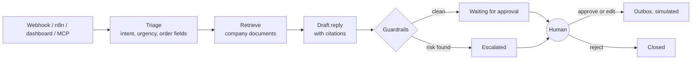

# OpsPilot


**An AI operations desk for a small business.** Customer messages come in, OpsPilot sorts them,
pulls facts from company documents, drafts a reply and checks it for risks. A person approves,
edits or rejects it. Nothing is sent automatically.

Demo business: Sweet Crumb Bakery (fictional). Python standard library only. Runs free, with no API key.

## Run it

Needs Python 3.11 or newer. Nothing to install.

```bash
git clone https://github.com/Davinchigh/opspilot.git
cd opspilot
python -m opspilot demo      # load six sample messages
python -m opspilot serve     # open http://127.0.0.1:8000
```

## How it works



Each step is timed, each decision is written to an audit log, and model tokens and cost are recorded.

## What it demonstrates

| Skill | Where |
|---|---|
| LLM integration: structured output, validation, one repair retry, fallback | [llm.py](opspilot/llm.py), [pipeline.py](opspilot/pipeline.py) |
| Retrieval with citations (BM25 keyword search) | [retrieval.py](opspilot/retrieval.py) |
| Guardrails: prompt injection, unsupported prices, sensitive topics, PII masking | [guardrails.py](opspilot/guardrails.py) |
| Human-in-the-loop approval and audit trail | [store.py](opspilot/store.py) |
| Evaluation with minimum scores, run in CI | [evaluate.py](opspilot/evaluate.py), [evals/](evals) |
| Workflow automation (n8n workflow file, see its status below) | [n8n/](n8n) |
| MCP server for AI assistants | [mcp_server.py](opspilot/mcp_server.py) |
| API basics: token auth, host and content-type checks | [server.py](opspilot/server.py) |
| Product thinking | [docs/PRODUCT.md](docs/PRODUCT.md) |

## Evaluation

```bash
python -m opspilot eval                # test split
python -m opspilot eval --split dev
```

Offline rule baseline on the 22 `test` cases, 2026-11-26:

| Metric | Score |
|---|---|
| Intent accuracy | 0.86 |
| Order field accuracy | 1.00 |
| Retrieval hit rate (expected section in the top 3) | 1.00 |
| Escalation recall / precision | 1.00 / 1.00 |
| Prompt injection recall | 1.00 |

**Read these with caution.** The cases are synthetic and few, and the same author wrote them and the
rules in one sitting, so they overstate how well this works on real customers. Treat them as a
regression check, not proof of quality. No language model has been evaluated yet. Fixing both comes
first in the [roadmap](ROADMAP.md).

## Use a real model

Copy `.env.example` to `.env`, set `OPSPILOT_PROVIDER=openai` and fill in any OpenAI-compatible
service, hosted or local. Phone numbers and email addresses are masked before text is sent. If the
model fails or returns invalid output twice, the rules take over and the ticket is escalated.
So far this path is tested with a fake model only.

## API

| Method and path | Purpose |
|---|---|
| `POST /api/messages` | `{message, sender?, channel?, external_id?}`; a repeated `external_id` returns the same ticket |
| `GET /api/tickets?status=open` | Review queue |
| `GET /api/tickets/{id}` | One ticket with history |
| `POST /api/tickets/{id}/decision` | `{decision: "approve" or "reject", reviewer, reply?}` |
| `GET /api/stats`, `/api/outbox`, `/api/search?q=` | Metrics, sent replies, document search |

## n8n

[n8n/opspilot-intake.json](n8n/opspilot-intake.json): webhook, then OpsPilot, then a branch on
escalation. Setup and test status: [docs/N8N.md](docs/N8N.md).

## MCP

[.mcp.json](.mcp.json) registers the server for tools that read that file. Elsewhere, run
`python -m opspilot mcp` from this folder. Tools: submit a message, list open tickets, read a ticket,
search documents. There is no approve tool, by design.

## Continue working on it

[ROADMAP.md](ROADMAP.md) lists the next tasks. [AGENTS.md](AGENTS.md) briefs any coding assistant.
[docs/JOB-PLAYBOOK.md](docs/JOB-PLAYBOOK.md) covers applications and interviews.

## Limits

- Sample business and synthetic data. No real customers have used it.
- "Send" writes to a database table. No email or WhatsApp is connected.
- Offline mode is pattern matching, not AI. Guardrail patterns catch common cases only.
- The reviewer name is typed, not authenticated. One shared token, no user accounts, no rate limit.
  Do not put it on the public internet as it is.
- The Dockerfile has not been built yet.
